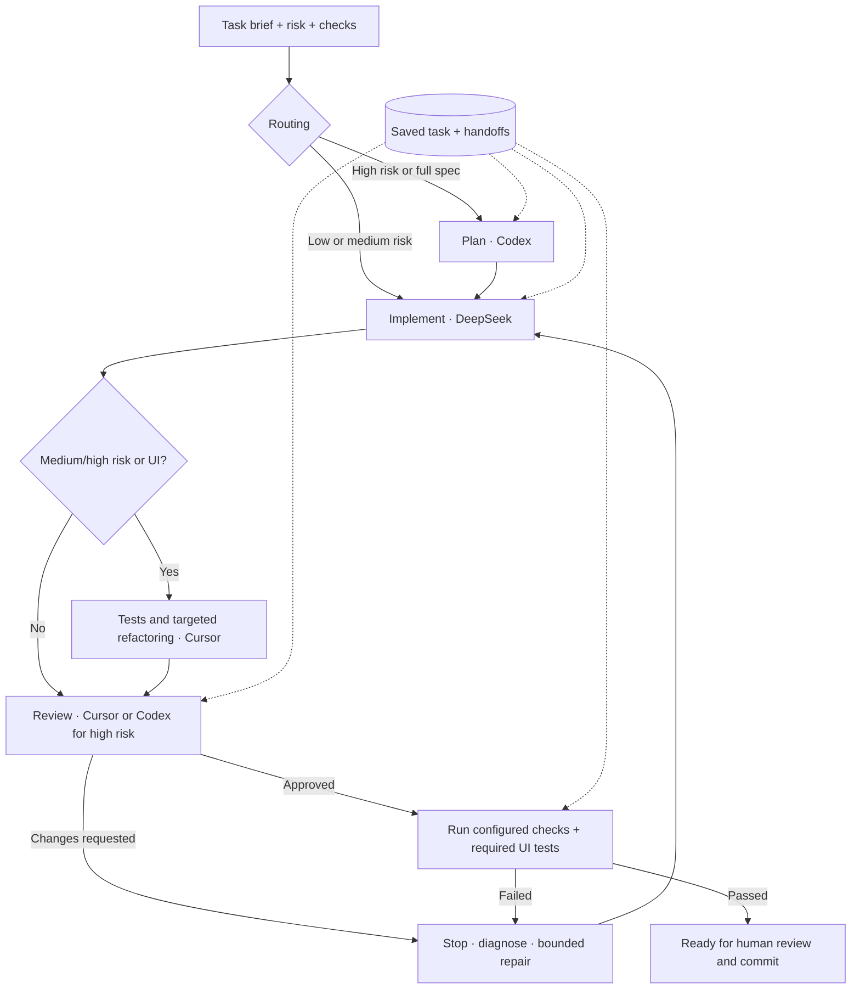

# Multi-model Workflow

A portable coding workflow that coordinates **Codex, DeepSeek, and Cursor**.
Use it from a terminal, OpenCode, Claude Code, or DeepSeek Harness TUI/web.
Every interface shares the same saved task, handoffs, and verification gates.

## How it works



Small tasks skip separate planning and test-authoring stages. Models and tools
are configurable. Source changes invalidate old approval; missing or failing
required checks block completion. The runner never commits or pushes automatically.
Failed planning must complete before implementation; repairs cannot skip it.

## Install

Requires **macOS/Linux, Python 3.10+, Git, and zsh**. Install and authenticate the
CLIs used by your roles: `codex`, Cursor `agent`, and Claude Code `claude` for the
DeepSeek adapter. Maestro and a device/emulator are needed for mobile UI checks.

```bash
git clone https://github.com/shahzadafridi/multi-model-workflow.git ~/workflow
zsh ~/workflow/install.sh
# Open a new terminal, or add the commands to this terminal:
export PATH="$HOME/workflow/bin:$HOME/.local/bin:$PATH"
mw doctor
```

Export `DEEPSEEK_API_KEY` through your private environment. The installer adds
home-level commands/skills and backs up replaced files. It does not configure
provider authentication. Restart open agent sessions to refresh discovery.

## Use from your preferred agent

Open your **product's Git checkout**, then enter:

| Interface | Start | Resume |
|---|---|---|
| Cursor, Claude Code, OpenCode, DeepSeek Harness | `/mw start Describe the change` | `/mw-resume TASK_ID` |
| Codex CLI or app | `$workflow start Describe the change` | `$workflow resume TASK_ID` |

The current agent coordinates configured CLI stages. Manual handoff is available
when an interface cannot launch a child CLI. Keep the same task ID when switching.

Existing flows: `/mw-ship-from-spec` (plan + UI), `/mw-ship-change` (UI required),
`/mw-commit-change` (no required UI), `/mw-review-update` (existing code + UI),
and `/mw-review-pr` (review only). Type `/mw` for the menu.

## Use from a terminal

```bash
cd /path/to/your/product
# Replace npm test with your project's real verification command.
mw start --risk medium --brief "Fix empty-state behavior" --check '["npm", "test"]'
# Use the task ID printed above:
mw run TASK_ID --once       # Execute one configured stage
mw resume TASK_ID          # Continue until complete or blocked
mw status TASK_ID          # Inspect progress and saved artifacts
```

Choose `--risk high` for permissions, payments, migrations, or major architecture
changes. Add `--ui` for adaptive tasks that change UI behavior, then configure an
executable UI check, for example:

```bash
mw checks TASK_ID --ui-check '["maestro", "test", "/absolute/path/to/flows"]'
# After diagnosing a failure:
mw repair TASK_ID --reason "Explain the diagnosed issue and next fix"
```

## Configure and learn more

Defaults: [config/default.json](config/default.json). Optional overrides:
`~/.config/workflow/config.json`. Run `mw config` to inspect effective settings.
Default limits are 12 stage attempts, 2 repairs, and 60 minutes of active process
time. Estimated spend caps are optional; they do not measure provider billing.

- [Full usage, manual handoffs, checks, budgets and configuration](docs/QUICKSTART.md)
- [Setup on another computer](docs/SETUP_ANY_COMPUTER.md)
- [Design and tradeoffs](docs/DESIGN.md) · [Validation and limitations](docs/VALIDATION.md)
- [Optional Bitbucket review integration](docs/BITBUCKET.md)

State and logs stay outside product checkouts in `~/.local/state/workflow`.
Project-specific `code-convention` / `code-review` skills are optional and are not
bundled. Authenticate model providers separately; paid access is not guaranteed.

Offline regression tests: `python3 -m unittest discover -s tests -v`.
